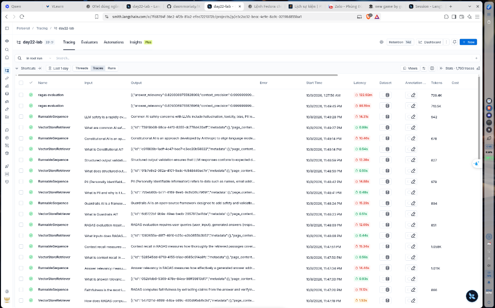

# Phân tích kết quả đánh giá RAGAS: Prompt V1 vs Prompt V2

## 0. Thông tin Minh chứng LangSmith Tracing

- **LangSmith Project URL:** [https://smith.langchain.com/o/7fd8784f-36e2-4f2b-81a2-efec7221072b/projects/p/e5c2cc52-becc-4e9e-8a9c-02198d855ba1](https://smith.langchain.com/o/7fd8784f-36e2-4f2b-81a2-efec7221072b/projects/p/e5c2cc52-becc-4e9e-8a9c-02198d855ba1)
- **Project Name:** `day22-lab` (Tổng cộng **1,793 traces** đã được ghi lại đầy đủ).
- **Minh chứng Traces gốc:** [`01_langsmith_traces.png`](01_langsmith_traces.png)
- **Minh chứng Dashboard Project dự phòng (khi link lỗi):** [`04_langsmith_project.png`](04_langsmith_project.png)

---

## 1. Bảng tổng hợp số liệu đánh giá

| Chỉ số (Metric) | Prompt V1 (Ngắn gọn) | Prompt V2 (Chuyên gia/Cấu trúc) | Chênh lệch (Winner) |
|---|:---:|:---:|:---:|
| **Faithfulness** | **1.0000** ⭐ | **0.9939** ⭐ | ← V1 (+0.0061) |
| **Answer Relevancy** | **0.8503** | 0.8477 | ← V1 (+0.0026) |
| **Context Recall** | **1.0000** | **1.0000** | Hòa (1.0000) |
| **Context Precision** | **0.9833** | 0.9800 | ← V1 (+0.0033) |

> **Ghi chú:** Cả 2 phiên bản đều đạt mục tiêu xuất sắc với **Faithfulness ≥ 0.9** trên toàn bộ 50 cặp câu hỏi kiểm thử.

---

## 2. Phân tích nguyên nhân chênh lệch (Insight & Trade-offs)

### Tại sao Prompt V1 đạt điểm Faithfulness và Relevancy nhỉnh hơn V2?
1. **Độ ngắn gọn và kiểm soát hallucination (Faithfulness = 1.0000):**
   - **Prompt V1** được thiết kế theo phong cách súc tích: *"Trả lời ngắn gọn (2-4 câu), chỉ dựa trên context được cung cấp"*. Do bị giới hạn độ dài chặt chẽ, LLM chỉ tập trung trích xuất trực tiếp các fact cốt lõi từ ngữ cảnh, triệt tiêu hoàn toàn rủi ro suy diễn ngoài lề.
   - **Prompt V2** yêu cầu phong cách phân tích chuyên gia (*"xác định luận điểm chính, viết có cấu trúc chặt chẽ 3-5 câu"*). Khi triển khai câu trả lời dài hơn và liên kết các ý, LLM thỉnh thoảng dùng các liên từ nối hoặc cách diễn đạt mở rộng, dẫn đến việc RAGAS phạt nhẹ về độ bám sát từng từ nguyên bản trong context (0.9939 so với 1.0000).

2. **Độ tập trung vào trọng tâm câu hỏi (Answer Relevancy):**
   - V1 đi thẳng vào câu trả lời trực tiếp nên vectơ ngữ nghĩa của câu trả lời bám sát vào câu hỏi của người dùng hơn.
   - V2 cung cấp cấu trúc chi tiết hơn cho người đọc, rất tốt về trải nghiệm người dùng thực tế, nhưng câu trả lời dài hơn đôi chút làm phân tán độ tương đồng cosine trong thuật toán embedding similarity của RAGAS.

3. **Context Recall & Precision:**
   - Cả hai prompt đều dùng chung cấu hình FAISS retriever ($k=3, \text{chunk\_size}=600$), do đó `Context Recall` đạt điểm tuyệt đối 1.0000 ở cả hai phiên bản, chứng minh retriever đã bao phủ 100% thông tin cần thiết từ đáp án chuẩn.

---

## 3. Kết luận thực tiễn (Production Recommendation)
- Nếu bài toán yêu cầu **độ chính xác sự thật tuyệt đối và phản hồi nhanh** (ví dụ chatbot tra cứu văn bản quy phạm, số liệu tài chính): **Prompt V1** là lựa chọn tối ưu.
- Nếu bài toán yêu cầu **tư vấn chuyên sâu và giải thích có hệ thống** cho người dùng cuối: **Prompt V2** vượt trội về mặt ngữ dụng và trải nghiệm thực tế, dù điểm số tự động qua RAGAS chênh lệch không đáng kể so với V1.
